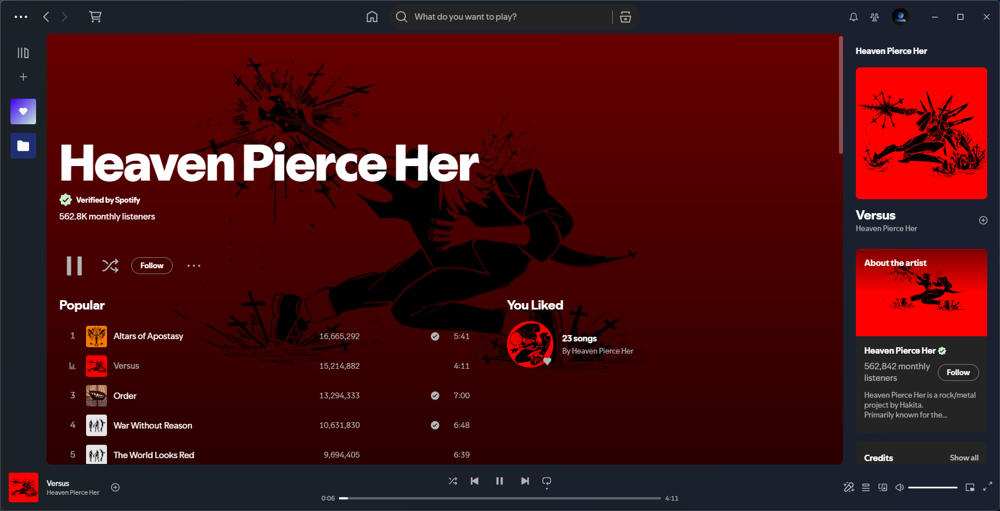

# Spicetify Mica

Author : [Ali Cool](https://github.com/AliCool412)

## About

A theme that basically turns all background elements transparent to mainly allow for Windows 11 Mica Backdrop, dark mode only.

Best used with [CEF/Spotify Tweaks](https://windhawk.net/mods/cef-titlebar-enabler-universal) windhawk mod, or [libcef-transparencey-linux](https://github.com/fixpointer/libcef-transparency-linux) by [fixpointer](https://github.com/fixpointer)

Special Thanks to [Ingan121](https://github.com/Ingan121) for helping make this theme work as intended through javascript, and creating the windhawk mod mentioned above.

Works as intended on versions 1.3.0 through 1.3.6

### Required CEF/Spotify Tweaks

- **Enable transparent rendering**
- **Disable forced dark mode**
  (Spotify adds a dark tint to the window by default, use this option to disable it so the theme works as intended.)

## Screenshots

### Album

### Artist Page

